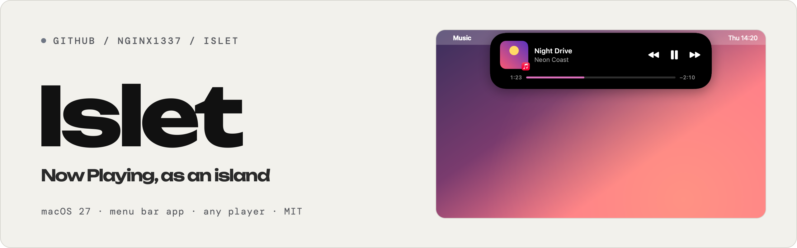
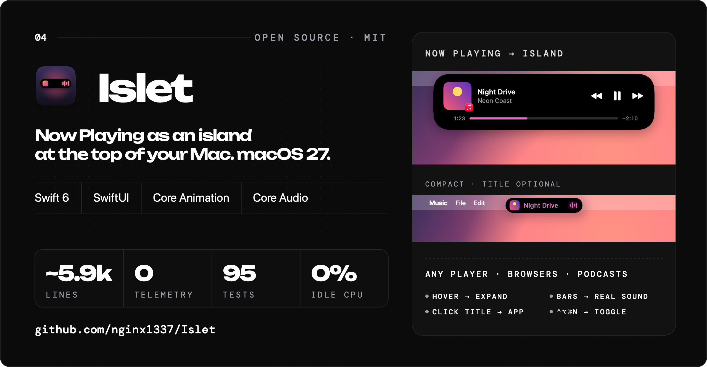
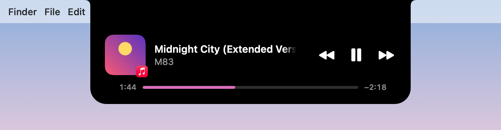
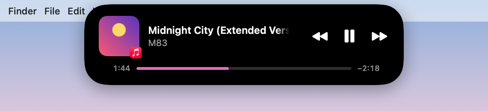
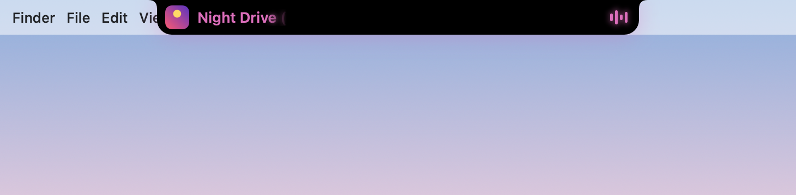

<picture>
  <source media="(prefers-color-scheme: dark)" srcset="docs/banner-dark.png">
  
</picture>

**Islet** — «Сейчас играет» в виде острова у верхнего края экрана, как Dynamic Island на iPhone. macOS 27.

На MacBook остров живёт прямо в чёлке и вырастает из неё, на внешнем мониторе это отдельная плавающая «таблетка». Слева обложка, справа эквалайзер в цвет обложки. Наведите курсор, и остров раскроется: крупная обложка, название, исполнитель, перемотка и кнопки. Работает с любым плеером: «Музыка», Spotify, браузеры, подкасты, VLC, IINA.

[English version](README.en.md)



| В чёлке MacBook | На внешнем мониторе |
|---|---|
|  |  |
|  |  |
|  |  |

## Как ведёт себя остров

- **Ничего не играет**: остров спрятан. В чёлке он совпадает с ней и не виден, на мониторе сжимается в точку и растворяется.
- **Играет**: свёрнутый вид, обложка и эквалайзер. Четыре полоски показывают настоящий звук Mac: бас, низкие и средние частоты, верха. Без разрешения на запись системного звука они просто анимируются.
- **Название в свёрнутом острове** (включается в настройках): между обложкой и полосками, в цвет обложки. Длинное название прокручивается, а на краях размывается.
- **Новый трек**: остров сам раскрывается на 3 секунды.
- **Наведение или щелчок**: раскрывается; когда курсор уходит, сворачивается через 0,4 с.
- **Пауза**: остров приглушается и через 15 секунд прячется (срок можно поменять или выключить).
- **⌃⌥⌘N** (меняется в настройках): раскрыть или свернуть остров на экране с курсором. Работает, даже когда остров спрятан на паузе, — удобно, чтобы продолжить.
- Щелчок по названию открывает приложение, которое играет. По полосе прогресса можно щёлкнуть или потянуть.
- «Назад» после 3 секунд воспроизведения начинает трек сначала. Если у плеера нет следующего трека (одно видео в браузере), «вперёд» перематывает на 15 с, и обе кнопки переключаются в режим ±15 с.
- В полноэкранных приложениях остров по умолчанию не показывается.

## Живые активности

Как в Dynamic Island: рядом с островом появляется вторая капсула. Главный остров показывает музыку, капсула — одну активность за раз (важнее — выше):

- **Таймер** и **секундомер**: запускаются из меню в строке меню. Нажатие на капсулу ставит на паузу и продолжает, при наведении появляются кнопки паузы и отмены. По окончании таймер звенит (звук отключается в настройках) и сам убирается через 10 секунд.
- **Зарядка**: подключили или отключили кабель, заряд упал до 20 %.
- **Bluetooth-наушники**: стали выходом звука (показывается название устройства).
- **Прогресс файлов** (по умолчанию выключено, экспериментально): копирование и загрузки, только процент.

Всё работает локально, без сети и без новых разрешений; каждый источник включается отдельно в настройках. Подробности — в [SECURITY.md](SECURITY.md).

## Сборка и запуск

Нужны macOS 27 и Command Line Tools (Xcode не обязателен). Платный аккаунт разработчика не нужен.

```bash
scripts/build-app.sh            # release → build/Islet.app
swift test                      # юнит-тесты ядра
scripts/test.sh                 # тесты, сборка и самопроверка запуска
```

Установка: перетащите `build/Islet.app` в «Программы» и откройте. Иконка появится в строке меню (в Dock её нет). Настройки — в меню этой иконки, или откройте Islet ещё раз из Finder.

Самопроверка: `build/Islet.app/Contents/MacOS/Islet --self-check` запускает приложение, печатает источник данных, текущий трек, экраны и острова и завершается с кодом 0 (всё в порядке), 2 (работает только запасной режим) или 1 (не работает). Она дожидается собственной проверки адаптера, поэтому заблокированный MediaRemote не выдаст ложное OK.

### Если macOS не даёт открыть

Сборка подписана ad-hoc, без Developer ID. Если вы скопировали `Islet.app` с другого Mac или скачали архив, macOS может сказать, что приложение повреждено или не проверено. Снимите карантин:

```bash
xattr -cr /Applications/Islet.app
```

Затем откройте снова (или правый щелчок → «Открыть»). Карантин также мешает системному `perl` загрузить встроенный фреймворк адаптера: в этом случае Islet перейдёт в запасной режим, а `xattr -cr` это исправит.

### Разрешения

- **Основной режим ничего не спрашивает.** Глобальное сочетание клавиш работает через Carbon `RegisterEventHotKey` и не требует «Универсального доступа». Курсор над островом отслеживается без особых прав.
- **Полоски по настоящему звуку** запрашивают «Запись системного звука» (Core Audio process tap). Islet только измеряет громкость по частотам: звук не записывается, не сохраняется и не меняется. Если вы отказали, включите Islet в Конфиденциальность и безопасность → Запись экрана и системного звука → «Только запись системного звука» (в настройках Islet есть кнопка) и перезапустите Islet. Ad-hoc подпись меняется при каждой пересборке, поэтому после пересборки macOS спросит снова.
- **Запасной режим** (см. ниже) управляет «Музыкой» и Spotify через AppleScript. При первом обращении macOS спросит: «Islet хочет управлять приложением „Музыка“». Ответ можно поменять в Системных настройках → Конфиденциальность и безопасность → Автоматизация.
- **Открывать при входе** включается в настройках Islet (`SMAppService`). Если macOS попросит подтверждение, оно в Системных настройках → Основные → Объекты входа.

## Откуда берутся данные

Начиная с macOS 15.4 закрытый фреймворк MediaRemote, через который система знает, что играет, отвечает только программам Apple. Islet использует [mediaremote-adapter](https://github.com/ungive/mediaremote-adapter): системный `/usr/bin/perl` подписан Apple, поэтому ему MediaRemote отвечает. Perl загружает маленький встроенный фреймворк, а тот печатает JSON-строки с изменениями (`stream`). Команды (пауза, дальше, назад, перемотка) уходят тем же путём. На этом Mac (macOS 27.0.1) всё это проверено: название, исполнитель, обложка, состояние, длительность, позиция, а также play/pause/next/previous/seek.

**Запасной режим.** Если адаптер не запустился, упал больше двух раз подряд или его собственная проверка (`test`) говорит, что MediaRemote закрыт, Islet переключается на «Музыку» и Spotify: их уведомления (`com.apple.Music.playerInfo`, `com.spotify.client.PlaybackStateChanged`) плюс AppleScript для позиции, обложки и управления. Плееры при этом не запускаются. Переключение видно в настройках одной строкой, там же кнопка «Повторить».

Позиция не опрашивается, а вычисляется: `elapsed + rate × (now − timestamp)`. Перерисовка 30 раз в секунду идёт, только когда остров раскрыт и трек играет. Обложки уменьшаются до 256 px, в памяти хранятся последние 20.

## Приватность и ресурсы

Подробно, с разрешениями и тем, как сообщить об уязвимости, — в [SECURITY.md](SECURITY.md).

- Ни телеметрии, ни аналитики. Единственный сетевой запрос — скачивание обложки Spotify в запасном режиме (Spotify отдаёт её ссылкой). Только картинка, без cookies, с кэшем.
- В простое процессор около 0 %. Захват звука и анализ (БПФ на 1024 точки, Accelerate) идут, только пока остров виден и трек играет: около 1–2 % процессора. Полоски — слои Core Animation. Когда остров спрятан или трек на паузе, нет ни захвата звука, ни таймеров, ни слежения за курсором.
- Без сторонних зависимостей, кроме встроенного адаптера.

## Как устроено

| Часть | Где |
|---|---|
| Логика без окон: разбор потока адаптера, конечный автомат, геометрия, интерполяция позиции, бегущая строка, цвет обложки, переключение источников | `Sources/IsletCore` (+ тесты) |
| Источники: адаптер через `/usr/bin/perl`, запасной «Музыка»/Spotify | `Sources/Islet/Sources` |
| Панели (`NSPanel` без активации, по одной на экран), слежение за курсором, смена экранов | `Sources/Islet/Island` |
| Остров на SwiftUI: форма «чёлка» с вогнутыми верхними углами, «таблетка», пружинные анимации, эквалайзер на Core Animation | `Sources/Islet/Island` |
| Меню в строке меню, настройки, хоткей, автозапуск | `Sources/Islet/Menu`, `Settings`, `System` |
| Адаптер MediaRemote (без изменений, BSD-3-Clause) | `Vendor/mediaremote-adapter`, собирается `scripts/build-adapter.sh` |

Стиль выбирается для каждого экрана отдельно: экран с вырезом (`safeAreaInsets.top > 0`, ширина выреза — из `auxiliaryTopLeftArea`/`auxiliaryTopRightArea`) получает «чёлку», остальные — «таблетку». Раскладка — чистая функция от описания экранов и настроек; она пересчитывается при подключении монитора, закрытии крышки и смене разрешения. Высота строки меню на мониторах берётся из `frame` и `visibleFrame`: на macOS 27 `NSStatusBar.system.thickness` возвращает 22 pt при настоящей высоте 30 pt, поэтому он используется только как запасное значение, когда строка меню скрыта.

Тесты (Swift Testing, 95 шт.): разбор JSON-потока (нормальный, пустой, битый, разрезанный на куски), все переходы автомата с подменёнными часами, кадры для экрана с вырезом, мониторов 1× и 2×, двух экранов и смены конфигурации, интерполяция, бегущая строка, доминирующий цвет на синтетических картинках, автопереключение источников, полоски на синтетических тонах (бас, середина, верха, тишина), кнопки «назад/вперёд».

## Ограничения

- Обход MediaRemote через Perl может перестать работать в будущей macOS. На этот случай есть запасной режим, но он умеет только «Музыку» и Spotify.
- При запуске Islet один раз выполняет проверку адаптера (`test`). Если в этот момент ничего не играет, она на долю секунды создаёт служебную запись «Сейчас играет» без названия; на остров это не влияет.
- Браузеры не всегда передают обложку (например, YouTube в Safari). Тогда вместо неё показывается значок браузера.
- Стиль «чёлка» проверен на макетах и в тестах. Живая проверка на этом Mac шла на мониторе 1440p (1×), с закрытой крышкой MacBook.
- Подпись ad-hoc. После пересборки macOS может снова спросить разрешение на «Автоматизацию». Для распространения подпишите Developer ID и нотарифицируйте.

## Отладка

```bash
log stream --level info --predicate 'subsystem == "app.islet"'
build/Islet.app/Contents/MacOS/Islet --self-check
swift build && $(swift build --show-bin-path)/Islet --render-preview out/   # PNG всех состояний (только отладочная сборка)
```

## Лицензия

MIT — см. [LICENSE](LICENSE).

Встроенный [mediaremote-adapter](https://github.com/ungive/mediaremote-adapter) © 2025 Jonas van den Berg and contributors, лицензия BSD 3-Clause — см. [Vendor/mediaremote-adapter/LICENSE](Vendor/mediaremote-adapter/LICENSE). Копия лицензии лежит и внутри приложения: `Contents/Resources/Licenses`.
